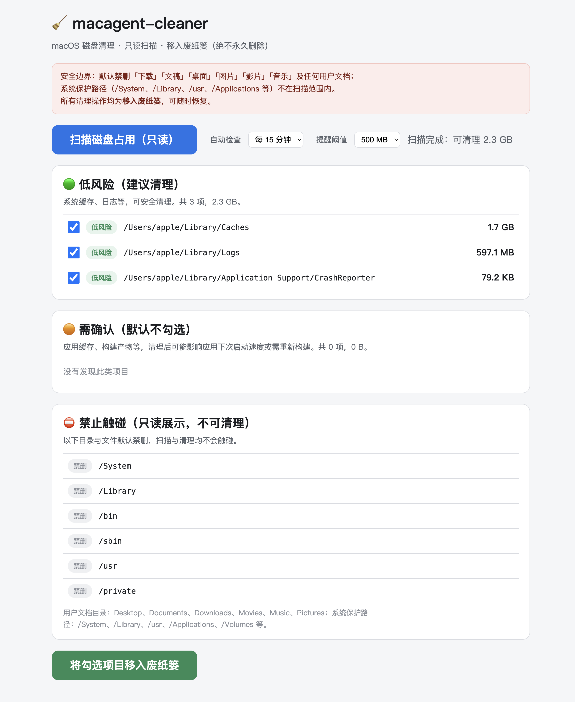
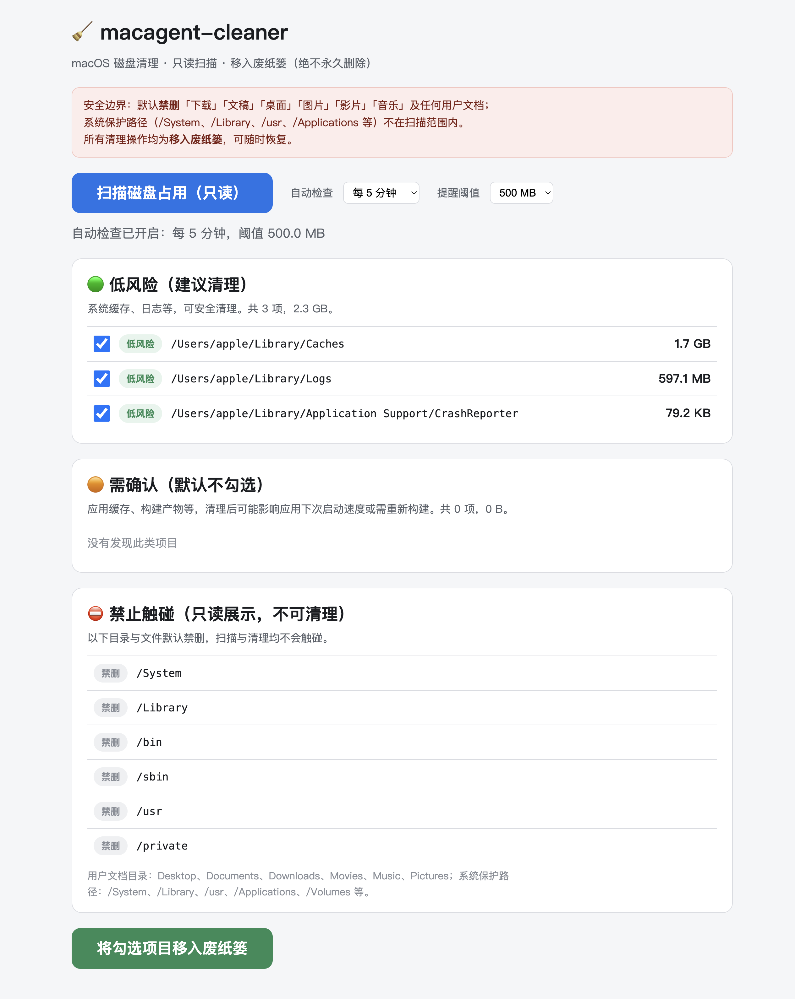

# 🧹 macagent-cleaner

<p align="center">
  <strong>为 agent 类工具清理 Mac 缓存</strong><br>
  只读扫描 · 风险分级 · 一键移入废纸篓
</p>

<p align="center">
  <a href="#这是什么">这是什么</a> •
  <a href="#功能特性">功能特性</a> •
  <a href="#快速开始">快速开始</a> •
  <a href="#界面预览">界面预览</a> •
  <a href="#它在清谁的缓存">它在清谁的缓存</a> •
  <a href="#安全边界">安全边界</a> •
  <a href="#项目结构">项目结构</a> •
  <a href="#开发计划">开发计划</a>
</p>

---

## 📖 这是什么？

macagent-cleaner 是运行在你 Mac 上的轻量清理器，专门为 **agent 类工具**（编程助手、自动化客户端等）设计——这类软件最擅长悄悄堆满缓存。

扫描磁盘 → 按风险分级 → 把可清理项移入废纸篓。全程只读，不碰你的文档，不永久删除。

> 🎯 磁盘满了？扫一下，看看是什么在吃空间，再决定清什么。

## ✨ 功能特性

### 📸 只读扫描
- 扫描系统缓存、日志、崩溃报告、应用缓存、构建产物
- 零写入：扫描过程不修改、不移动、不删除任何文件

### 🚦 三级风险分级
- **低风险**：系统缓存、日志 —— 默认勾选，一键清理
- **需确认**：应用缓存、构建产物 —— 手动确认
- **禁删**：下载、文稿、桌面、系统路径 —— 只读展示，不可操作

### 🗑️ 废纸篓清理
- 所有清理一律移入 `~/.Trash`，可随时恢复
- 绝不永久删除，是否清空由你决定

### 🏷️ 软件归属自动识别
- 扫描到的每个缓存目录自动识别**归属软件**与**归类**（如 `@qoder-updater/Cache` → **Qoder · IDE 编辑器**）
- 不用猜路径，一眼看出缓存在为谁打工

### ⏰ 定时自动检查
- 页面内置自动检查：每 5 / 15 / 30 / 60 分钟自动重新扫描
- 可清理量达到提醒阈值（100 MB / 500 MB / 1 GB）时状态栏醒目提示

### 🖥️ 眼动仪友好界面
- 本地网页 UI，仅绑定 `127.0.0.1`
- 大按钮、大字号、清晰路径，无手也能轻松操作

## 🚀 快速开始

要求：macOS 10.15+，Python 3.8+，零第三方依赖（暂不支持 Linux，见[开发计划](#-开发计划)）。

```bash
python3 webui.py
```

浏览器打开 <http://127.0.0.1:8765>，点击「扫描磁盘占用」，勾选后点击「移入废纸篓」。

界面顶部可开启**自动检查**：选择间隔与提醒阈值，页面会定时重新扫描并在达到阈值时提示。

命令行模式：

```bash
python3 scanner.py --output scan.json
python3 cleaner.py --paths '["/Users/me/Library/Caches/com.apple.Safari"]'
```

## 🖼️ 界面预览

真实运行截图（macOS，`http://127.0.0.1:8765`，扫描结果 2.3 GB 可清理）：

| 扫描结果分级 | 开启定时自动检查 |
| --- | --- |
|  |  |

左侧为三级风险分区展示（低风险默认勾选），右侧为开启「自动检查 · 每 5 分钟」后的状态。

## 🧹 它在清谁的缓存

扫描结果中，每个缓存目录会**自动标注归属徽标**（软件名 + 归类），不再是一串看不懂的路径。

| 路径关键词（示例） | 识别为 | 归类 |
| --- | --- | --- |
| `@qoder-updater` | Qoder | IDE 编辑器 |
| `Trae` | Trae | IDE 编辑器 |
| `Cursor` | Cursor | IDE 编辑器 |
| `Windsurf` | Windsurf | IDE 编辑器 |
| `Claude` | Claude Code | 终端 CLI |
| `Codex` | Codex CLI | 终端 CLI |
| `Gemini` | Gemini CLI | 终端 CLI |
| `OpenCode` / `opencodedesktop` | OpenCode | 终端 CLI |
| `ZCode` | ZCode | 桌面客户端 |
| `Raccoon` | Raccoon | 桌面客户端 |
| `WorkBuddy` | WorkBuddy | 桌面客户端 |
| `Marvis` | Marvis | 桌面客户端 |
| `mmx-agent` | MMX Agent | 桌面客户端 |
| `AgnesCode` | AgnesCode | 桌面客户端 |
| `Playwright` / `Puppeteer` | Playwright / Puppeteer | 开发工具 |
| `Homebrew` / `uv` / `node-gyp` | Homebrew / uv / node-gyp | 开发工具 |
| `Tabbit` | Tabbit | 浏览器 |
| `Bambu` | Bambu Studio | 应用 |

> 匹配规则集中在 `scanner.py` 的 `VENDOR_RULES`，未命中的目录标记为通用项，可自行扩展。

## 🔒 安全边界

| 边界 | 说明 |
| --- | --- |
| 禁删用户文档 | 下载、文稿、桌面、图片、影片、音乐及其中任何文件 |
| 禁删系统路径 | /System、/Library、/usr、/Applications、/Volumes 等 |
| 只读扫描 | 扫描过程不修改任何文件 |
| 可恢复清理 | 仅移入废纸篓，由你决定是否清空 |
| 白名单校验 | 可清理项必须在允许的基目录内，否则一律拒绝 |

## 📁 项目结构

```
macagent-cleaner/
├── scanner.py     # 磁盘占用扫描与风险分级（只读）
├── cleaner.py     # 路径安全校验与移入废纸篓
├── webui.py       # 本地网页界面（眼动仪友好）
├── docs/
│   ├── main.png   # 扫描结果分级截图
│   └── clean.png  # 勾选待清理截图
├── requirements.txt
└── README.md
```

## 🗺️ 开发计划

- [x] 只读扫描与三级分级
- [x] 废纸篓清理与安全校验
- [x] 本地网页界面
- [x] 真实运行截图
- [x] 软件归属自动识别
- [x] 定时自动检查（间隔 + 阈值提醒）
- [ ] Linux 路径适配（`~/.cache` / `~/.config` 体系）
- [ ] 清理统计与报告导出
- [ ] 更多 agent 软件缓存目录覆盖

## 🤝 参与贡献

欢迎提交 Issue 和 Pull Request。新增扫描目录前，请确认其属于「可安全清理」类型。

## 📄 开源协议

本项目基于 [MIT](LICENSE) 开源。

---

<p align="center">
  ⭐ 觉得有用？给个 Star 支持一下！
</p>
**
